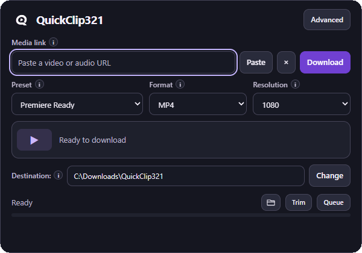

<p align="center"></p>
<h1 align="center">QuickClip321</h1>
<p align="center">A Windows tray app for downloading and organizing video and audio.</p>
<p align="center"><a href="https://github.com/Tuna321/QuickClip321/releases">Download for Windows</a> · <a href="#development">Development</a> · <a href="LICENSE">MIT License</a></p>



## What it does

- Paste a link, preview the media, and choose a format and resolution from the quick view.
- Add batches, select playlists, trim clips, or save subtitle files in the advanced workspace.
- Follow active downloads, review history, and export redacted diagnostics.
- Organize saved files into Video, Audio, and Unsorted folders using local rules.
- Use the app without an AI provider. Optional AI suggestions are disabled by default.

## Run on Windows

1. Download `QuickClip321-2.1.0-rc.1-win-x64.exe` from [GitHub Releases](https://github.com/Tuna321/QuickClip321/releases).
2. Get a Windows build through [FFmpeg's download page](https://ffmpeg.org/download.html). Put `ffmpeg.exe` and `ffprobe.exe` on PATH, or place both in a `bin` folder next to QuickClip321.
3. Open QuickClip321. The EXE includes Python and Node.js.

### Run from source

With Python 3.12 and FFmpeg installed, run these commands from the repository root in PowerShell:

```powershell
py -3.12 -m venv .venv
.\.venv\Scripts\python.exe -m pip install -r requirements-test-lock.txt
.\.venv\Scripts\python.exe -m quickclip321
```

Use the system tray icon to reopen the window after hiding it. Pass `--start-hidden` to start with only the tray icon. Use media you have permission to download.

## Development

```powershell
.\.venv\Scripts\python.exe -m pytest -q
.\.venv\Scripts\python.exe -m ruff check quickclip321 tests tools
```

To build the public EXE, put the Windows x64 `node.exe` in `bin/`, make FFmpeg and ffprobe available for tests, and run `build_portable.ps1 -PublicRelease`. The script runs checks before packaging. Build output goes to `dist/`.

QuickClip321's source code is [MIT licensed](LICENSE). Bundled components retain their own terms. See [third-party licensing and rebuild instructions](docs/THIRD-PARTY.md).
