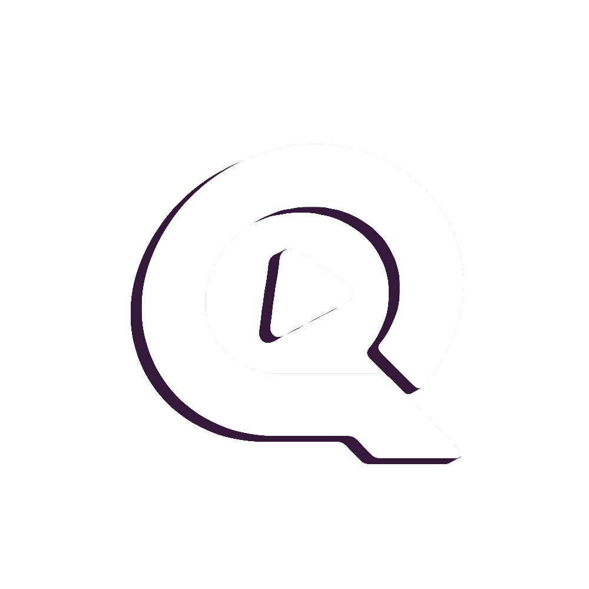
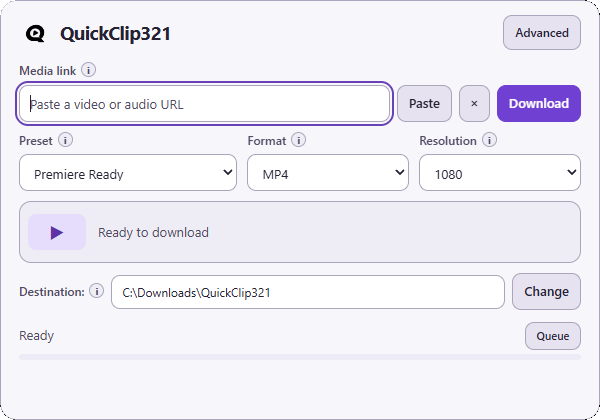

<h1 align="center">QuickClip321</h1>

<strong>Copy. Click. Download.</strong> Free, open-source video and audio downloader for Windows. Built for creators, made for everyone.

<a href="https://github.com/Tuna321/QuickClip321/releases/download/v3.0.0-beta.2/QuickClip321-3.0.0-beta.2-win-x64-portable.zip"><strong>Download ZIP (3.5 MiB)</strong></a> | <a href="https://github.com/Tuna321/QuickClip321/releases/tag/v3.0.0-beta.2">Release notes</a> | <a href="#get-started">Get started</a> | <a href="https://github.com/Tuna321/QuickClip321/issues/new/choose">Give feedback</a>

## Your media. Your workflow.

QuickClip321 stays in your Windows notification area. Copy a media link, open the popup, choose a format and download. No account, no subscription, no browser extension required.

| **Premiere Ready** | **Fast Download** | **Audio** |
| --- | --- | --- |
| Editing-friendly MP4 | Original format, without extra compatibility conversion | MP3 for audio workflows |

Format and resolution are independently adjustable. Save your own presets in the advanced workspace.

## Get started

1. **[Download Beta 2 for Windows x64](https://github.com/Tuna321/QuickClip321/releases/download/v3.0.0-beta.2/QuickClip321-3.0.0-beta.2-win-x64-portable.zip).** Extract the ZIP into a permanent folder, then open **QuickClip321.exe**.
2. **Copy a media link.** Click the Q icon in the system tray (look under the hidden icons arrow if necessary).
3. **Choose and download.** Select your preset, format and resolution. If prompted, select **Set up tools** and confirm the verified media-tool download.

**Requirements:** Windows x64 with the Microsoft Edge WebView2 Runtime. The portable ZIP is approximately 3.5 MiB. First-use setup may download approximately 170-200 MB of media tools. No admin rights or global PATH modifications are required by the managed setup.

> [!IMPORTANT]
> This is a public beta, not a stable release. V3 uses separate settings and history from V2. The executable is unsigned; Windows may warn or block it. Verify the ZIP against the release's SHA-256 checksum and keep Windows security enabled. Run on startup is enabled by default and can be disabled in Settings.

## Small on the outside. Powerful underneath.

| Feature | What you can do |
| --- | --- |
| Clipboard capture | Bring a copied link into the popup, without auto-downloading. |
| Media formats | MP4, original, MP3, M4A and WAV; available quality depends on the source. |
| Advanced downloads | Batch links, playlists, optional clipping, available subtitles and metadata. |
| Queue | Run up to three simultaneous jobs, cancel or retry, and review history. |
| Notifications | Get a Windows notification when a download completes or fails. |
| Smart organizer | Sort media using 2,302 curated entries, custom title rules and folder overrides. |
| Appearance | Choose light/dark palettes, accents, optional textures and popup position. |

Light theme | the same quick workflow, a different look.

### Keep your downloads organized

Music, rap, pop, rock/metal, electronic, film, TV, games and more. The organizer uses local contextual rules and metadata rather than sending the library to an AI service. Choose broad folders or detailed categories. A manually chosen destination overrides automatic routing.

<strong>See the advanced organizer</strong>

 

## Help shape V3

This is the first public Rust-based beta. Try it in your everyday workflow and tell us what feels slow, confusing or missing.

- [Report a bug or request a feature](https://github.com/Tuna321/QuickClip321/issues/new/choose).
- Include the version, Windows version, steps to reproduce and a reviewed error message. Do not share private links, cookies or credentials.
- If it makes your workflow easier, [star the project](https://github.com/Tuna321/QuickClip321/stargazers).

## Good to know

How do I verify the download?

 Download SHA256SUMS.txt from the release. In PowerShell run <code>Get-FileHash .\QuickClip321-3.0.0-beta.2-win-x64-portable.zip -Algorithm SHA256</code> and compare the hash. A matching hash confirms the ZIP matches the published artifact, not that it is digitally signed.

Does it work with every website?

 Media support depends on <a href="https://github.com/yt-dlp/yt-dlp">yt-dlp</a> and the source. Some websites, thumbnails, formats and resolutions may be unavailable. Only save media you are authorized to download.

Can I pause and resume downloads?

 Eligible single Original downloads can reuse partial data. Other formats and playlists do not yet have general active-transfer resume. Waiting jobs can be held and resumed.

Why are there WebView2 processes in Task Manager?

 The current V3 interface uses Microsoft's WebView2 runtime. The separate native Rust prototype is not the published app.

How do I stop startup or remove it?

 Turn off Run on startup in Advanced &gt; Settings, exit using the tray menu, and delete the extracted application folder. Settings, history and managed tools remain in the V3 application data folder; remove them only if you no longer need them. Downloads are stored separately.

## Developers

The V3 application uses Rust, Tauri and WebView2, with separately installed yt-dlp, FFmpeg/FFprobe and Node.js media tools. Source, lockfiles and build commands are available in [V3 development documentation](v3/README.md). See [V3 licensing and dependencies](docs/V3-THIRD-PARTY.md), [release notes](https://github.com/Tuna321/QuickClip321/releases/tag/v3.0.0-beta.2) and the [legacy Python release](https://github.com/Tuna321/QuickClip321/releases/tag/v2.1.0-rc.2).

<strong>Made by 321. Built to stay out of your way.</strong> <a href="LICENSE">MIT License</a> | <a href="https://github.com/Tuna321/QuickClip321/issues">Community</a>

