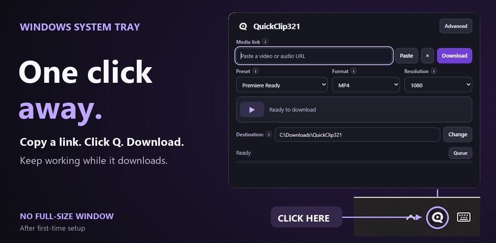
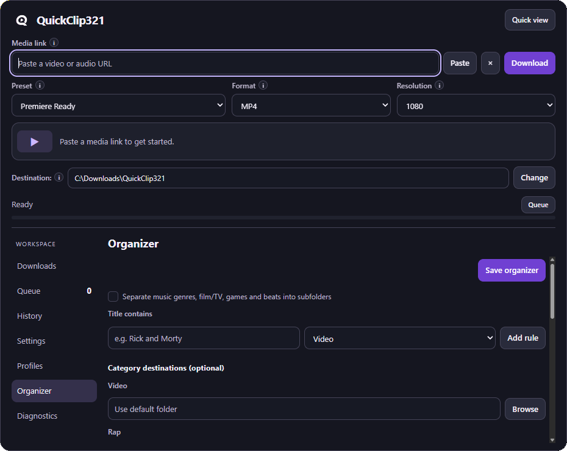
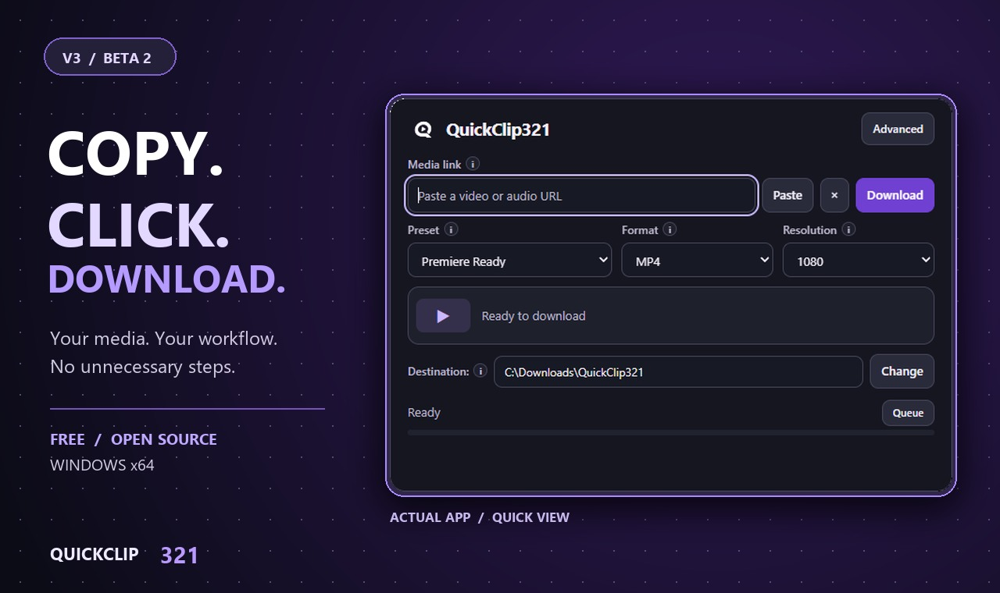

<picture>
<source media="(prefers-color-scheme: dark)" srcset="v3/assets/beta2-logo-dark.png">
<source media="(prefers-color-scheme: light)" srcset="v3/assets/beta2-logo-light.png">

</picture>

<h1 align="center">QuickClip321</h1>

<strong>Copy. Click. Download.</strong> Download video and audio without leaving your workflow. A free, open-source Windows downloader built around your system tray and keyboard.

Windows x64 &nbsp; / &nbsp; Portable EXE &nbsp; / &nbsp; Beta 5

<strong>FREE &nbsp; / &nbsp; MIT LICENSE &nbsp; / &nbsp; RUST</strong>

<a href="https://github.com/Tuna321/QuickClip321/releases/download/v3.0.0-beta.5/QuickClip321-3.0.0-beta.5-win-x64.exe"><strong>Download EXE (12.63 MB)</strong></a> | <a href="https://github.com/Tuna321/QuickClip321/releases/download/v3.0.0-beta.5/QuickClip321-3.0.0-beta.5-win-x64-portable.zip">ZIP (3.93 MB)</a> | <a href="https://github.com/Tuna321/QuickClip321/releases/tag/v3.0.0-beta.5">Release notes</a> | <a href="#get-started">Get started</a> | <a href="https://github.com/Tuna321/QuickClip321/issues/new/choose">Give feedback</a>

| **12.63 MB** | **25,693** | **8 shortcuts** | **Free & open source** |
| :---: | :---: | :---: | :---: |
| Portable EXE | Local catalog records | Fully customizable | MIT-licensed & open source |

EXE size excludes separately installed media tools. Catalog count includes curated and contextual title records.

## 01 / Download without opening a window

**Copy a link. Press a shortcut. Keep working.**

No need to switch to a downloader window, paste a URL or choose the same settings over and over. QuickClip321 runs in your system tray and can start a download from your keyboard while you are editing, browsing or working in another app.

| Copy a link, then press | Get |
| --- | --- |
| <kbd>Ctrl</kbd> + <kbd>Shift</kbd> + <kbd>3</kbd> | MP3 audio |
| <kbd>Ctrl</kbd> + <kbd>Shift</kbd> + <kbd>4</kbd> | Editor-ready MP4 |
| <kbd>Ctrl</kbd> + <kbd>Shift</kbd> + <kbd>D</kbd> | Your last-used format |
| <kbd>Ctrl</kbd> + <kbd>Alt</kbd> + <kbd>Space</kbd> | Open / hide QuickClip321 |
| <kbd>Ctrl</kbd> + <kbd>Shift</kbd> + <kbd>O</kbd> | Open your download folder |

Your destination and quality are remembered. A small, native fade notification confirms the action without taking focus away from your work. All eight global and in-app shortcuts can be changed, disabled or tested in **Advanced > Shortcuts**. Global shortcuts work while QuickClip321 is running, even with its popup hidden.

## 02 / A small download. A complete workflow.

**12.63 MB portable EXE. Just 3.93 MB as a ZIP.**

QuickClip321 is built with Rust and uses the Windows WebView2 runtime. Download the standalone executable, save it in a permanent folder and open it. There is no large application installer or account setup.

On first launch, missing media tools are automatically downloaded, verified and configured. Live progress shows what is being installed. No manual FFmpeg setup, administrator privileges or system PATH edits.

The EXE size refers to QuickClip321 itself. First-time media-tool setup may require approximately 170-200 MB of additional downloads; WebView2 is required. Small file size is not a claim about RAM use.

## 03 / 25,693 records. Less file chaos.

**Download your media. Let QuickClip321 help sort it.**

The local organizer recognizes artists, games, movies, TV shows and music genres using curated titles, contextual matching and available media metadata. The library works locally, without sending classification requests to an AI service.

| **5,215** | **8,066** | **5,124** | **7,288** |
| :---: | :---: | :---: | :---: |
| Games | Films | TV series | Music records |

Choose broad or detailed categories, add your own title rules, or assign custom folders. A manually chosen destination takes precedence. Matching is contextual, not guaranteed for every title.

<strong>See the organizer interface</strong>

 

## 04 / One simple popup. Everything you need.

**Simple by default. Advanced when you want it.**

Prefer clicking instead of keyboard shortcuts? Copy a link and click the Q icon in the system tray. With clipboard capture enabled, your link is already waiting. Choose a format, resolution and destination, then download. Keep working as transfers continue in the background.

Actual Beta 2 quick-view screenshot. Beta 5 adds shortcuts, size estimates and more controls.

| **Premiere Ready** | **Fast Download** | **Audio** |
| --- | --- | --- |
| Editing-friendly MP4 | Original format without extra compatibility conversion | MP3, M4A or WAV |

Switch between quick view and the advanced workspace. Customize themes, accents, popup position and always-on-top behavior. English and Turkish interface options are available.

## 05 / Download what you need, not the whole video.

**Need a five-second clip? Try downloading just that part.**

Set clip start and end before downloading. For eligible short video clips, QuickClip321 first tries to retrieve the requested section, checks the result, and falls back to a full download and trim when necessary. Supported sources can save substantial transfer time and bandwidth.

Estimated source transfer size helps you choose quality. During eligible downloads, the preview can sample frames from the existing partial file without fetching a second video. Source support and container layout determine availability.

## More control, without clutter

| Feature | What you can do |
| --- | --- |
| Batch and playlists | Queue multiple links or supported playlists. |
| Background queue | Run up to three simultaneous jobs, hold waiting jobs, cancel or retry, and review history. |
| Notifications | Get Windows notifications when downloads complete or fail. |
| Profiles | Save your favorite format and resolution combinations. |
| Subtitles and metadata | Retrieve available subtitles and optional media metadata. |
| Local settings | Keep custom rules, preferences and history between launches. |

## Get started

1. **[Download Beta 5 for Windows x64](https://github.com/Tuna321/QuickClip321/releases/download/v3.0.0-beta.5/QuickClip321-3.0.0-beta.5-win-x64.exe).** Save the EXE in a permanent folder and open it.
2. Let the one-time verified media-tool setup finish if required.
3. Copy a media link. Press a shortcut or click the Q icon in the notification area and hit Download.

**Requirements:** Windows x64 and Microsoft Edge WebView2. First-use media-tool setup may download approximately 170-200 MB.

> [!IMPORTANT]
> This is an unsigned public beta, not a stable release. Verify the download against the release SHA-256 checksum and keep Windows security enabled. Run on startup is enabled by default and can be disabled in Settings. Media compatibility depends on the source. Only save media you have permission to download.

## Help shape V3

QuickClip321 V3 is in public beta. Try it in your everyday workflow and tell us what feels slow, confusing or missing.

- [Report a bug or request a feature](https://github.com/Tuna321/QuickClip321/issues/new/choose).
- Include the version, Windows version, steps to reproduce and a reviewed error message. Do not share private links, cookies or credentials.
- If it makes your workflow easier, [star the project](https://github.com/Tuna321/QuickClip321/stargazers).

## Good to know

How do I verify the download?

 Download <a href="https://github.com/Tuna321/QuickClip321/releases/download/v3.0.0-beta.5/SHA256-EXE.txt">SHA256-EXE.txt</a> from the release. In PowerShell run <code>Get-FileHash .\QuickClip321-3.0.0-beta.5-win-x64.exe -Algorithm SHA256</code> and compare the hash. For the ZIP, use SHA256SUMS.txt. A matching hash confirms the download matches the published artifact, not that it is digitally signed.

Does it work with every website?

 Media support depends on <a href="https://github.com/yt-dlp/yt-dlp">yt-dlp</a> and the source. Some websites, thumbnails, formats and resolutions may be unavailable. Only save media you are authorized to download.

Can I pause and resume downloads?

 Eligible single Original downloads can reuse partial data. Other formats and playlists do not yet have general active-transfer resume. Waiting jobs can be held and resumed.

Why are there WebView2 processes in Task Manager?

 The current V3 interface uses Microsoft's WebView2 runtime. The separate native Rust prototype is not the published app.

How do I stop startup or remove it?

 Turn off Run on startup in Advanced &gt; Settings, exit using the tray menu, and delete the downloaded EXE or extracted application folder. Settings, history and managed tools remain in the V3 application data folder; remove them only if you no longer need them. Downloads are stored separately.

## Developers

The V3 application uses Rust, Tauri and WebView2, with separately installed yt-dlp, FFmpeg/FFprobe and Node.js media tools. Source, lockfiles and build commands are available in [V3 development documentation](v3/README.md). See [V3 licensing and dependencies](docs/V3-THIRD-PARTY.md), [license and notices for the EXE](https://github.com/Tuna321/QuickClip321/releases/download/v3.0.0-beta.5/LICENSE-AND-NOTICES.txt) and [release notes](https://github.com/Tuna321/QuickClip321/releases/tag/v3.0.0-beta.5).

<strong>Made by 321. Built to stay out of your way.</strong> <a href="LICENSE">MIT License</a> | <a href="https://github.com/Tuna321/QuickClip321/issues">Community</a>

