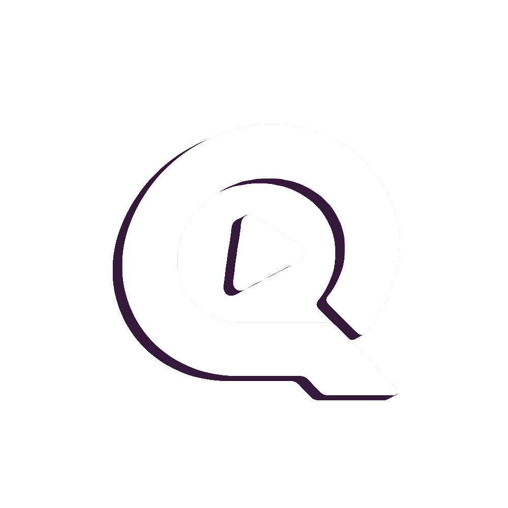
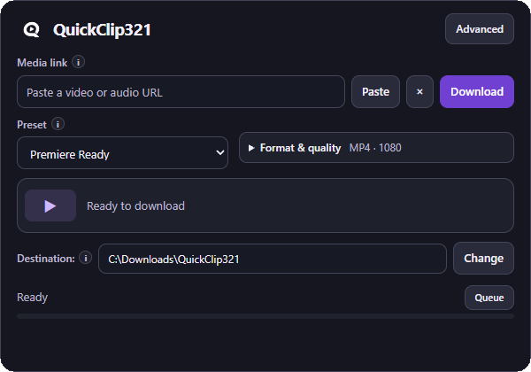
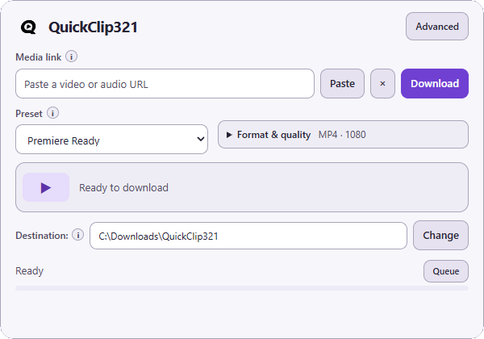

<h1 align="center">QuickClip321</h1>

<strong>Copy. Click. Download.</strong> From link to timeline — without the clutter.

<a href="https://github.com/Tuna321/QuickClip321/releases"><strong>Current public releases</strong></a> · <a href="#how-it-works">How it works</a> · <a href="https://github.com/Tuna321/QuickClip321/issues">Feedback</a>

> [!IMPORTANT]
> V3 is under development, not a public stable release. The existing public release is a different implementation. This page is the release design draft; publish only after the release gates pass.

## How it works

**1. Copy a media link.** Find a video or audio file that you have permission to download.

**2. Open QuickClip321.** It lives in your Windows notification area. If clipboard capture is enabled, your copied link is ready when you open it.

**3. Download.** Choose an everyday preset. QuickClip handles the media tools and organizes the result according to your preferences.

## Choose the workflow, not the command line

| Premiere Ready | Fast Download | Audio |
| --- | --- | --- |
| Editor-friendly MP4, verified for compatible video and audio codecs. | Keep the best available source format without extra compatibility conversion. | Extract audio to MP3; optional M4A/WAV settings. |

Need more control? Format, quality, queue, batch links, clip trimming, subtitles, saved presets and organizer rules are available in the advanced workspace.

## A place for every file

Local organizer rules recognize 2,302 catalog entries: 1,485 music artists and groups, 336 films, 310 series and 171 games. Choose broad Audio/Video folders or more detailed categories. Add your own title rules and category destinations. Manual destinations always win.

The catalog is curated, not a universal media database. Context and metadata reduce false matches; unclear content falls back to a general folder.

## Personalize your workspace

Choose your color palette, accent, popup position and optional surface finish. The Quick view stays small; advanced settings stay out of the way until needed.

## Getting started

V3 currently requires a tested Windows x64 development build. Managed setup downloads version-pinned media tools from official sources, verifies SHA-256, and stores them inside the app's own data directory. No administrator access or global PATH changes. This has passed an isolated setup test; clean-machine deployment is still a release gate.

Use the existing public release link above for the currently distributed version. Do not download unsigned binaries from unofficial mirrors. When a V3 installer exists, this section will contain its exact version, checksums, requirements and a clear explanation of signing status.

## Built in the open

QuickClip321 V3 uses Rust and [yt-dlp](https://github.com/yt-dlp/yt-dlp), [FFmpeg](https://ffmpeg.org/) and [Node.js](https://nodejs.org/). Media support depends on the source and extractor. Controlled pause/resume is currently limited to eligible single Original downloads; the WebView-free native frontend is a separate prototype. See [release gates](RELEASE-GATES.md) and [development documentation](README.md).

Report a reproducible issue with your app/Windows version and steps. Never include credentials, cookies, private links, clipboard contents or unreviewed logs. Contributions and feature suggestions are welcome.

<strong>Made for creators. Built to stay out of your way.</strong> <a href="../LICENSE">MIT License</a>

